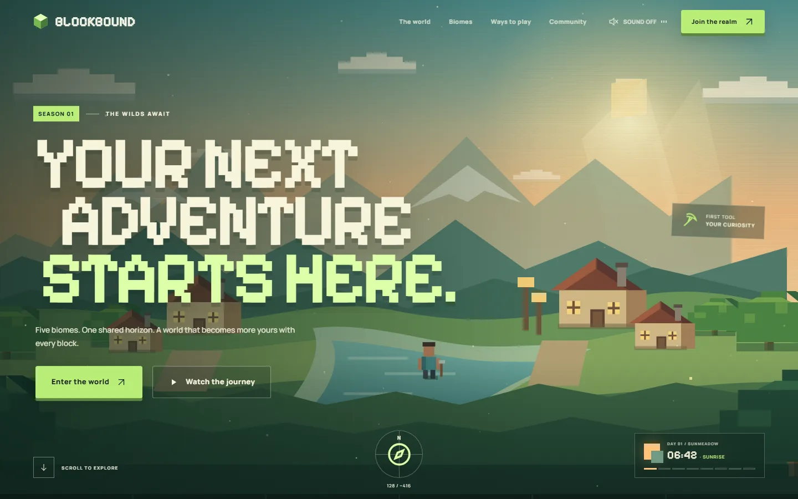
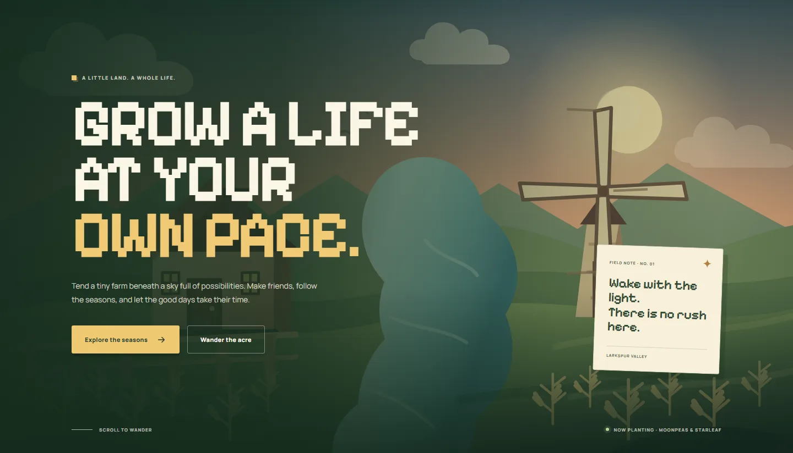
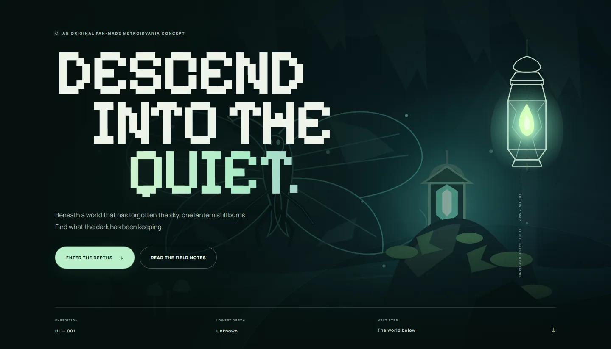
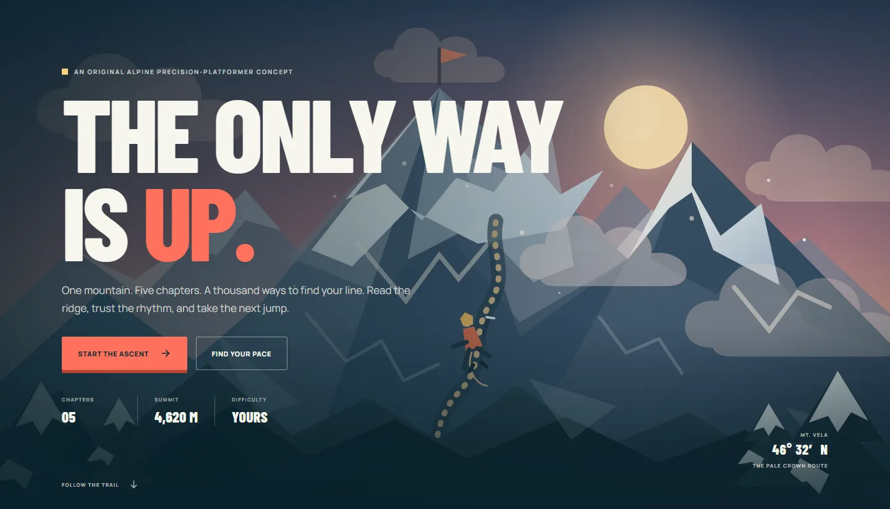
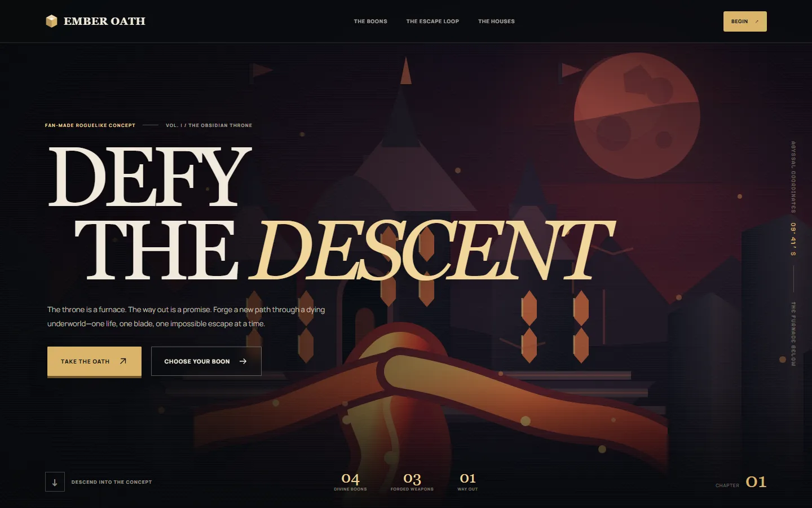
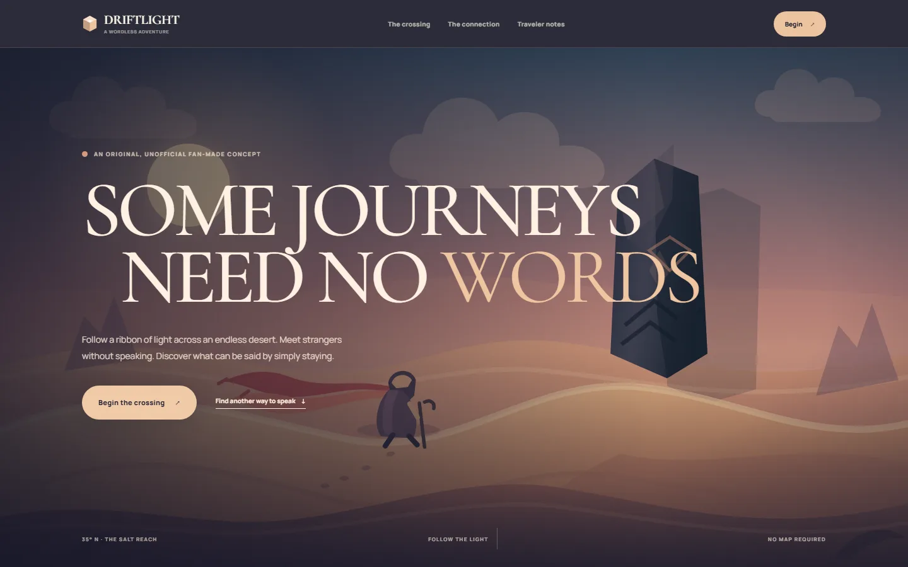
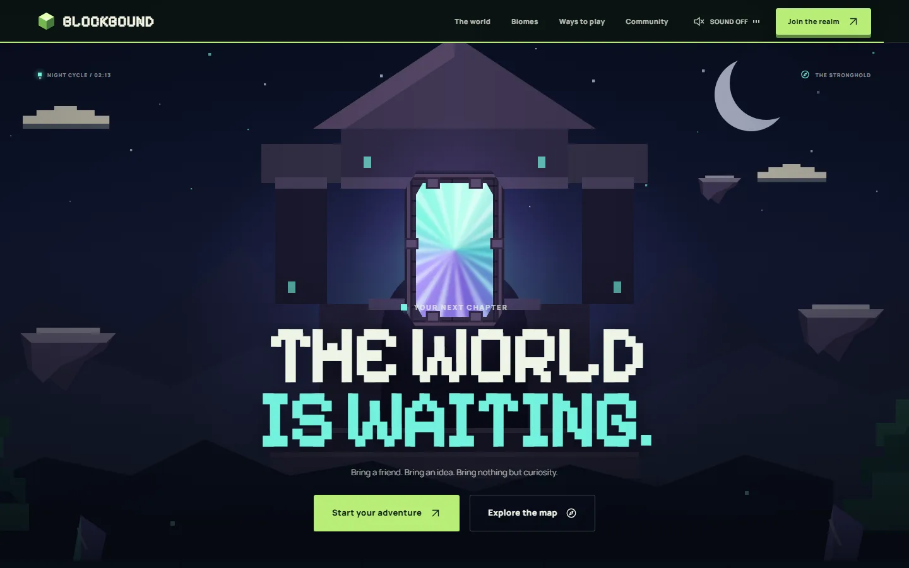

<div align="center">


# HUNGER G SHOWCASE

**Original ideas. Working experiences. Public proof.**

Six live examples from **Hunger G on OpenCode Go** — original worlds you can open, inspect, run, and learn from.

[](https://devvgwardo.github.io/hunger-g-showcase/)
[](https://github.com/DevvGwardo/hunger-g-showcase/actions/workflows/ci.yml)
[](https://devvgwardo.github.io/hunger-g-showcase/#examples)
[](https://devvgwardo.github.io/hunger-g-showcase/blockbound/)

</div>

---

## Six worlds. One growing collection.

### BLOCKBOUND

An original, fan-made voxel-world landing page that turns scrolling into a journey: sunrise village, deep forest, crystal caverns, ember wastes, and a luminous Stronghold.



**Five biomes. One shared horizon. A world that responds to every block.**

- Original SVG/CSS voxel artwork — no copied game textures or proprietary assets
- GSAP-powered hero parallax and pinned biome exploration
- Pointer-responsive depth, atmospheric particles, and animated environmental lighting
- Optional synthesized soundscape that changes with the active biome
- Guided journey player, interactive feature cards, filterable gallery, and native accessible dialogs
- Static reduced-motion experience and responsive desktop, tablet, and mobile layouts

<div align="center">

[**Enter BLOCKBOUND**](https://devvgwardo.github.io/hunger-g-showcase/blockbound/) &nbsp;·&nbsp; [**View the source**](examples/blockbound) &nbsp;·&nbsp; [**Read its build notes**](examples/blockbound/README.md)

</div>

---

## The collection

Six showcase slots, six live landing-page experiences, one shared quality bar.

| Slot | Experience | Focus | Source | Status |
| :---: | :--- | :--- | :---: | :---: |
| **001** | [**BLOCKBOUND**](https://devvgwardo.github.io/hunger-g-showcase/blockbound/) | Minecraft-inspired voxel-world landing page | [Source](examples/blockbound) | 🟢 **Live** |
| **002** | [**Starfall Acre**](https://devvgwardo.github.io/hunger-g-showcase/starfall-acre/) | Stardew Valley-inspired cozy farming landing page; season selector | [Source](examples/starfall-acre) | 🟢 **Live** |
| **003** | [**Hollowlight**](https://devvgwardo.github.io/hunger-g-showcase/hollowlight/) | Hollow Knight-inspired atmospheric metroidvania landing page; realm selector | [Source](examples/hollowlight) | 🟢 **Live** |
| **004** | [**Summit**](https://devvgwardo.github.io/hunger-g-showcase/summit/) | Celeste-inspired precision-platformer landing page; chapter trail selector | [Source](examples/summit) | 🟢 **Live** |
| **005** | [**Ember Oath**](https://devvgwardo.github.io/hunger-g-showcase/ember-oath/) | Hades-inspired roguelike landing page; boon selector and random boon | [Source](examples/ember-oath) | 🟢 **Live** |
| **006** | [**Driftlight**](https://devvgwardo.github.io/hunger-g-showcase/driftlight/) | Journey-inspired wordless-adventure landing page; chapter travel log | [Source](examples/driftlight) | 🟢 **Live** |

The showcase gives every entry a consistent stage: context, visuals, quality signals, a live demo, and reproducible source. Extended notes for the five newer landing pages are in [GAME_CONCEPTS.md](examples/GAME_CONCEPTS.md).

### The five new worlds

| | | |
| :---: | :---: | :---: |
|  |  |  |
| **STARFALL ACRE** | **HOLLOWLIGHT** | **SUMMIT** |
|  |  | <div align="center"><br><strong>SIX LIVE EXAMPLES</strong><br><small>Original art, real interactions, public source.</small></div> |
| **EMBER OATH** | **DRIFTLIGHT** | **HUNGER G SHOWCASE** |

### Game-concept matrix

These are original, unofficial fan-made landing pages. Named inspirations identify genre, tone, pacing, and broad interaction references only; they do not imply endorsement, and no assets, characters, music, level data, or game code are copied.

| Experience | Inspiration | Genre | Signature interaction | Fan-made disclaimer |
| :--- | :--- | :--- | :--- | :--- |
| **BLOCKBOUND** | Minecraft | Interactive voxel landing page | Scroll-pinned travel through five connected biomes | Unofficial; not affiliated with Mojang or Microsoft; original SVG/CSS artwork |
| **Starfall Acre** | Stardew Valley | Cozy farming landing page | Season selector updates the garden, crops, weather, rhythm, and palette | Unofficial; not affiliated with ConcernedApe; original artwork and writing |
| **Hollowlight** | Hollow Knight | Atmospheric metroidvania landing page | Realm selector updates the scene, hazards, rewards, and marked route | Unofficial; not affiliated with Team Cherry; original world, characters, and artwork |
| **Summit** | Celeste | Precision-platformer landing page | Chapter trail selector updates the route profile, mechanics, and challenge code | Unofficial; not affiliated with Maddy Makes Games; original routes, artwork, and writing |
| **Ember Oath** | Hades | Roguelike landing page | Inspect and bind a boon, or summon a random boon | Unofficial; not affiliated with Supergiant Games; original boons, weapons, characters, and artwork |
| **Driftlight** | Journey | Wordless-adventure landing page | Chapter travel log updates the artwork, terrain, encounters, and reflection | Unofficial; not affiliated with thatgamecompany; original desert, travelers, and artwork |

---

## What is Hunger G?

Hunger G is the building partner inside **OpenCode Go** that helps turn an idea into a working interactive result.

This repository is the public proof-of-work: not a gallery of prompts, but a collection of finished experiences you can open, inspect, run, and learn from.

> **Intent in. Working result out.**

The goal is simple: make ambitious ideas tangible, keep the source open, and raise the bar with every release.

---

## How the work gets made

Hunger G follows a clear product workflow. The infographic describes the process at a product level — not private model internals.


| Stage | What it means |
| :--- | :--- |
| **01 · Listen** | Turn a rough idea into a clear brief with a real audience, purpose, and definition of done. |
| **02 · Shape** | Choose the interaction model, visual direction, technical scope, and accessibility constraints. |
| **03 · Build** | Create the interface, behavior, content, and original artwork as one coherent system. |
| **04 · Verify** | Test interactions, responsive layouts, keyboard flow, reduced motion, performance, and production output. |
| **05 · Ship** | Package the result with documentation, CI, a live deployment, and a reproducible local setup. |

---

## BLOCKBOUND, in detail

| | |
| :---: | :--- |
|  |  |
| **A world with depth** | **A gallery with a story** |
| Five distinct palettes, environmental effects, hazards, resources, and atmospheric motion. | Original adventure moments with category filters, smooth transitions, and keyboard-navigable field notes. |
|  |  |
| **Ways to play** | **A dramatic finish** |
| Tactile voxel cards, useful field notes, and content that explains how each mode feels. | A living cyan portal, drifting particles, cinematic night lighting, and a real downloadable starter guide. |

### BLOCKBOUND verified quality

These measurements describe the BLOCKBOUND production build; they are not claimed as scores for the entire collection.

| Check | Result |
| :--- | :--- |
| Lighthouse performance | **97** |
| Lighthouse accessibility | **100** |
| Lighthouse best practices | **100** |
| Lighthouse SEO | **100** |
| Automated WCAG 2.1 AA scans | **Passing** |
| Playwright interaction tests | **8 passing** |
| Largest Contentful Paint | **1.0 s** |
| Cumulative Layout Shift | **0.001** |

---

## Run it locally

Requirements: **Node.js 20+**, npm, and Git.

```bash
git clone https://github.com/DevvGwardo/hunger-g-showcase.git
cd hunger-g-showcase
npm install
npm run dev --workspace=starfall-acre
```

Open the local URL printed by Vite. Replace `starfall-acre` with any workspace from the collection:

| Example | Start development |
| :--- | :--- |
| **BLOCKBOUND** | `npm run dev --workspace=blockbound` |
| **Starfall Acre** | `npm run dev --workspace=starfall-acre` |
| **Hollowlight** | `npm run dev --workspace=hollowlight` |
| **Summit** | `npm run dev --workspace=summit` |
| **Ember Oath** | `npm run dev --workspace=ember-oath` |
| **Driftlight** | `npm run dev --workspace=driftlight` |

### Verify an example

Use the same workspace suffix with the quality commands. For Starfall Acre:

```bash
npm run lint --workspace=starfall-acre
npm run typecheck --workspace=starfall-acre
npm run build --workspace=starfall-acre
```

Install the Playwright browser once with `npx playwright install chromium`, then use the root test commands below.

### Collection commands

| Command | Purpose |
| :--- | :--- |
| `npm run dev` | Start the default BLOCKBOUND development server |
| `npm run lint` | Run ESLint across **all workspaces** with zero warnings allowed |
| `npm run typecheck` | Run strict TypeScript checks across **all workspaces** |
| `npm run build` | Create production builds for **all workspaces** |
| `npm test` | Run BLOCKBOUND's Playwright interaction, responsive, and accessibility checks |
| `npm run test:showcase` | Run static-site checks for **all six examples** |
| `npm run build:pages` | Build the showcase and all six deployable demos for GitHub Pages |

Each example's `package.json` defines its development, lint, typecheck, build, and preview scripts.

---

## Repository map

```text
hunger-g-showcase/
├── showcase/                       # Public showcase site
│   ├── index.html
│   ├── styles.css
│   └── assets/                     # Original infographic + optimized media
├── examples/
│   ├── GAME_CONCEPTS.md            # Premises, art, landing-page controls, and access notes
│   ├── blockbound/                 # 001 — voxel-world landing page
│   ├── starfall-acre/              # 002 — cozy farming landing page
│   ├── hollowlight/                # 003 — atmospheric metroidvania landing page
│   ├── summit/                     # 004 — precision-platformer landing page
│   ├── ember-oath/                 # 005 — roguelike landing page
│   ├── driftlight/                 # 006 — wordless-adventure landing page
│   └── shared/                     # Shared example configuration and utilities
├── scripts/
│   └── build-pages.mjs             # Builds showcase + examples for GitHub Pages
└── .github/
    ├── workflows/                  # CI and Pages deployment
    └── ISSUE_TEMPLATE/             # Showcase submission form
```

---

## The showcase standard

Every example in this repository aims to be:

1. **Original** — custom visuals, copy, sound, and interactions with clear credits for references.
2. **Useful** — real actions, meaningful states, responsive behavior, and no decorative dead ends.
3. **Accessible** — keyboard navigation, visible focus, semantic structure, readable contrast, and reduced-motion support.
4. **Fast** — local assets, optimized media, restrained animation, and measured performance.
5. **Reproducible** — setup instructions, clean source, automated checks, and a public deployment.

### Fan-made and asset policy

All six entries are unofficial fan-made landing pages. Their named inspirations—Minecraft, Stardew Valley, Hollow Knight, Celeste, Hades, and Journey—identify genre, tone, pacing, and broad interaction references only; none implies endorsement or affiliation. Game artwork, copy, animation, and sound must be created for this repository, and assets must not be extracted, downloaded, traced, or adapted from existing games. Libraries and fonts may be used only under their own licenses, with attribution preserved. See the full [no-copied-assets policy](examples/GAME_CONCEPTS.md#originality-and-no-copied-assets-policy).

---

## Help shape what comes next

The first six showcase slots are live. Have an idea with a little ambition behind it? Use the showcase submission form.

[**Propose a showcase example →**](https://github.com/DevvGwardo/hunger-g-showcase/issues/new?template=showcase-submission.yml)

A strong submission includes:

- What someone can explore, learn, or create
- A repository or demo URL, if one exists
- How Hunger G helped shape the workflow
- Confirmation that the work is original, responsive, documented, and accessible

Please do not include private model details, credentials, or account information.

---

## Built in the open

This repository uses GitHub Actions for linting, typechecking, production builds, Playwright tests, and GitHub Pages deployment. Every example ships with a live URL, readable source, and local setup instructions.

<div align="center">

**Hunger G × OpenCode Go**

*Original experiments. Public source. One growing collection.*

</div>

---

BLOCKBOUND, Starfall Acre, Hollowlight, Summit, Ember Oath, and Driftlight are original, unofficial fan-made landing-page concepts inspired respectively by Minecraft, Stardew Valley, Hollow Knight, Celeste, Hades, and Journey. None is affiliated with or endorsed by the creators or publishers of its named inspiration, and no copied game assets are used.
