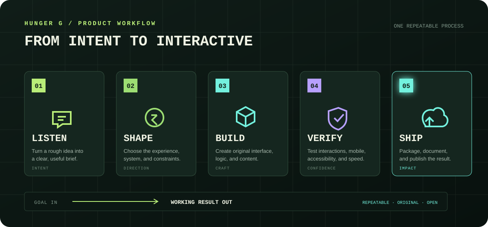
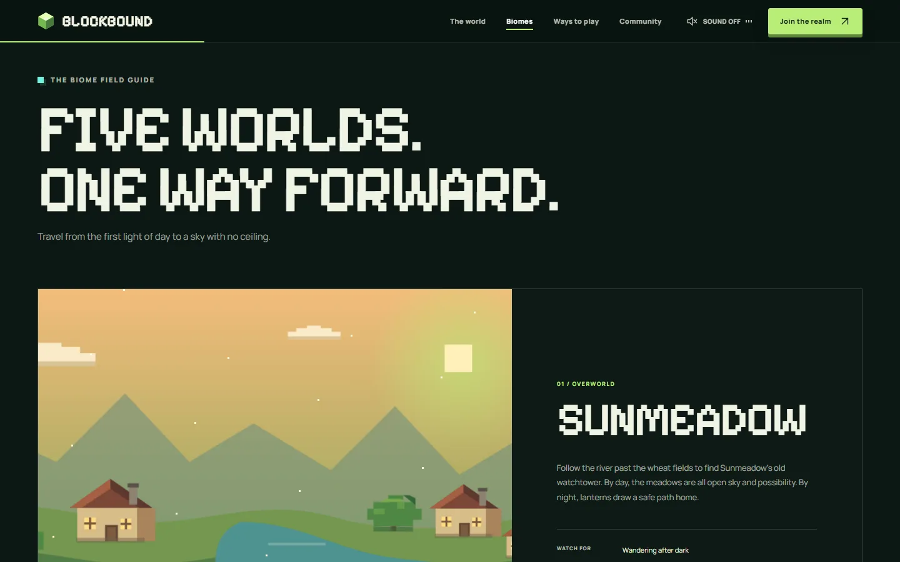
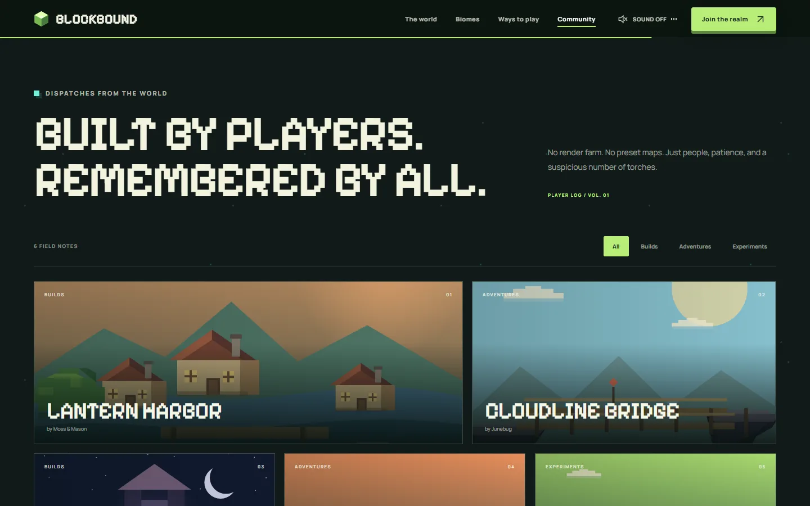
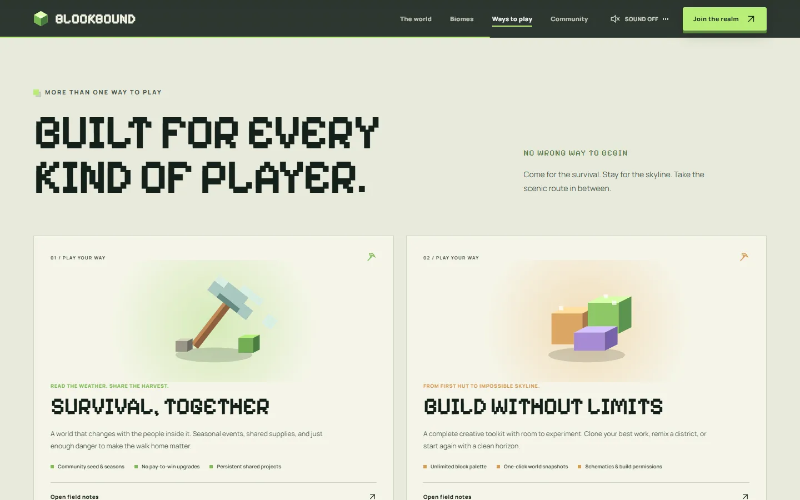

<div align="center">


# HUNGER G SHOWCASE

**Original ideas. Working experiences. Public proof.**

The first public experiment from **Hunger G on OpenCode Go** — and the first home for everything we build next.

[](https://devvgwardo.github.io/hunger-g-showcase/)
[](https://github.com/DevvGwardo/hunger-g-showcase/actions/workflows/ci.yml)
[](https://devvgwardo.github.io/hunger-g-showcase/#examples)
[](https://devvgwardo.github.io/hunger-g-showcase/blockbound/)

</div>

---

## The first world is live.

### BLOCKBOUND

An original, fan-made voxel-world landing page that turns scrolling into a journey: sunrise village, deep forest, crystal caverns, ember wastes, and a luminous Stronghold.


**Five biomes. One shared horizon. A world that responds to every block.**

- Original SVG/CSS voxel artwork — no copied game textures or proprietary assets
- GSAP-powered hero parallax and pinned biome exploration
- Pointer-responsive depth, atmospheric particles, and animated environmental lighting
- Optional synthesized soundscape that changes with the active biome
- Guided journey player, interactive feature cards, filterable gallery, and native accessible dialogs
- Static reduced-motion experience and responsive desktop, tablet, and mobile layouts

<div align="center">

[**Enter BLOCKBOUND**](https://devvgwardo.github.io/hunger-g-showcase/blockbound/) &nbsp;·&nbsp; [**View the source**](https://github.com/DevvGwardo/hunger-g-showcase/tree/main/examples/blockbound) &nbsp;·&nbsp; [**Read its build notes**](examples/blockbound/README.md)

</div>

---

## The collection

Six showcase slots. One live experiment. Five open horizons.

| Slot | Experience | Focus | Status |
| :---: | :--- | :--- | :---: |
| **001** | [**BLOCKBOUND**](https://devvgwardo.github.io/hunger-g-showcase/blockbound/) | Immersive voxel landing page | 🟢 **Live** |
| **002** | Interactive story | Narrative people can move through | ⬜ Open slot |
| **003** | Creative tool | A playful instrument for making | ⬜ Open slot |
| **004** | Developer utility | A sharper tool for real work | ⬜ Open slot |
| **005** | Learning experience | Complex ideas made tangible | ⬜ Open slot |
| **006** | Unexpected experiment | A surprising interaction worth trying | ⬜ Open slot |

The showcase site gives every entry a consistent stage: context, visuals, quality signals, a live demo, and reproducible source.

---

## What is Hunger G?

Hunger G is the building partner inside **OpenCode Go** that helps turn an idea into a working interactive result.

This repository is the public proof-of-work: not a gallery of prompts, but a collection of finished experiences you can open, inspect, run, and learn from.

> **Intent in. Working result out.**

The goal is simple: make ambitious ideas tangible, keep the source open, and raise the bar with every release.

---

## How the work gets made

Hunger G follows a clear product workflow. The infographic describes the process at a product level — not private model internals.



| Stage | What it means |
| :--- | :--- |
| **01 · Listen** | Turn a rough idea into a clear brief with a real audience, purpose, and definition of done. |
| **02 · Shape** | Choose the interaction model, visual direction, technical scope, and accessibility constraints. |
| **03 · Build** | Create the interface, behavior, content, and original artwork as one coherent system. |
| **04 · Verify** | Test interactions, responsive layouts, keyboard flow, reduced motion, performance, and production output. |
| **05 · Ship** | Package the result with documentation, CI, a live deployment, and a reproducible local setup. |

---

## BLOCKBOUND, in detail

| | |
| :---: | :--- |
|  |  |
| **A world with depth** | **A gallery with a story** |
| Five distinct palettes, environmental effects, hazards, resources, and atmospheric motion. | Original adventure moments with category filters, smooth transitions, and keyboard-navigable field notes. |
|  |  |
| **Ways to play** | **A dramatic finish** |
| Tactile voxel cards, useful field notes, and content that explains how each mode feels. | A living cyan portal, drifting particles, cinematic night lighting, and a real downloadable starter guide. |

### Verified quality

| Check | Result |
| :--- | :---: |
| Lighthouse performance | **97** |
| Lighthouse accessibility | **100** |
| Lighthouse best practices | **100** |
| Lighthouse SEO | **100** |
| Automated WCAG 2.1 AA scans | **Passing** |
| Playwright interaction tests | **8 passing** |
| Largest Contentful Paint | **1.0 s** |
| Cumulative Layout Shift | **0.001** |

---

## Run it locally

Requirements: **Node.js 20+** and npm.

```bash
git clone https://github.com/DevvGwardo/hunger-g-showcase.git
cd hunger-g-showcase
npm install
npm run dev
```

Open the local URL printed by Vite.

### Root commands

| Command | Purpose |
| :--- | :--- |
| `npm run dev` | Start the BLOCKBOUND development server |
| `npm run lint` | Run ESLint with zero warnings allowed |
| `npm run typecheck` | Run strict TypeScript checks |
| `npm run build` | Create the production build |
| `npm test` | Run Playwright interaction, responsive, and accessibility tests |
| `npm run build:pages` | Build the showcase site and deployable BLOCKBOUND demo |

---

## Repository map

```text
hunger-g-showcase/
├── showcase/                 # Public showcase site
│   ├── index.html
│   ├── styles.css
│   └── assets/               # Original infographic + optimized screenshots
├── examples/
│   └── blockbound/           # The first complete example
│       ├── src/              # React components, scenes, hooks, and styles
│       ├── public/           # Favicon and downloadable field guide
│       └── tests/            # Playwright interaction and WCAG checks
├── scripts/
│   └── build-pages.mjs       # Builds showcase + example for GitHub Pages
└── .github/
    ├── workflows/            # CI and Pages deployment
    └── ISSUE_TEMPLATE/       # Showcase submission form
```

---

## The showcase standard

Every example in this repository aims to be:

1. **Original** — custom visuals, copy, and interactions with clear credits for references.
2. **Useful** — real actions, meaningful states, responsive behavior, and no decorative dead ends.
3. **Accessible** — keyboard navigation, visible focus, semantic structure, readable contrast, and reduced-motion support.
4. **Fast** — local assets, optimized media, restrained animation, and measured performance.
5. **Reproducible** — setup instructions, clean source, automated checks, and a public deployment.

---

## Submit the next example

Have an idea with a little ambition behind it? Use the showcase submission form.

[**Propose a showcase example →**](https://github.com/DevvGwardo/hunger-g-showcase/issues/new?template=showcase-submission.yml)

A strong submission includes:

- What someone can explore, learn, or create
- A repository or demo URL, if one exists
- How Hunger G helped shape the workflow
- Confirmation that the work is original, responsive, documented, and accessible

Please do not include private model details, credentials, or account information.

---

## Built in the open

This repository uses GitHub Actions for linting, typechecking, production builds, Playwright tests, and GitHub Pages deployment.

<div align="center">

**Hunger G × OpenCode Go**

*Original experiments. Public source. One growing collection.*

</div>

---

BLOCKBOUND is an original fan-made concept and is not affiliated with Mojang or Microsoft. All BLOCKBOUND artwork in this repository was created specifically for the showcase.
